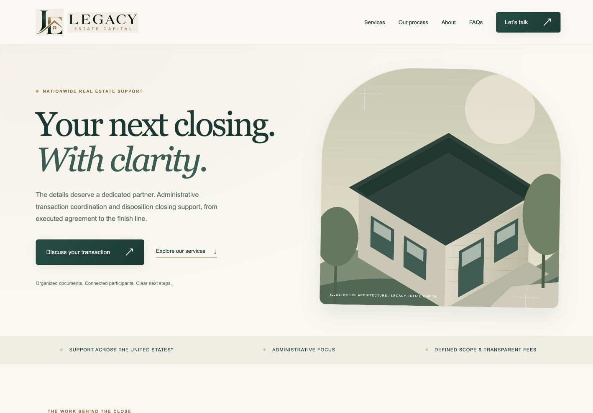
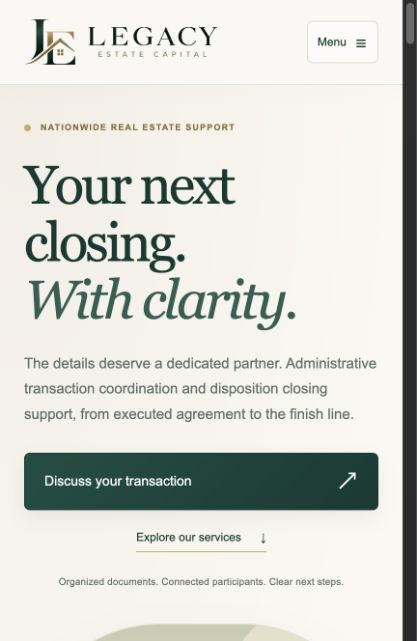

# Legacy Estate Capital

A responsive real estate transaction-coordination website built with **Next.js, React, and a small PHP enquiry endpoint**, deployed to conventional shared hosting.

[Live website](https://legacyestatecapital.com/) · [Architecture](docs/architecture.md) · [Deployment guide](docs/deployment.md)



## The brief

Create a distinctive, conversion-focused presence for Legacy Estate Capital, owned by Colette Louise. Explain a broad administrative service offering without implying brokerage, legal representation, or professional licensure. Deliver a modern frontend on hosting that supports Apache and PHP rather than requiring a persistent Node.js application.

## Engineering highlights

- **Hosting-aware architecture.** Next.js generates static HTML, CSS, and JavaScript; Apache serves the export and PHP handles enquiries. No Node process is needed in production.
- **A complete conversion journey.** Service discovery, a four-step workflow, owner introduction, FAQs, and an enquiry form with explicit response consent.
- **Responsive brand system.** Emerald, sage, gold, and ivory tokens; original brand artwork; mobile navigation; single-column service cards and form controls.
- **Search and sharing fundamentals.** Page metadata, canonical URLs, Open Graph imagery, structured data, sitemap, and robots output.
- **Accessible interaction patterns.** Skip navigation, labeled inputs, an announced form status, expandable FAQs, and reduced-motion styles.
- **Private enquiry persistence.** Server validation, a honeypot, a per-network cooldown, and JSON records outside the public document root. Notification mail is attempted after saving.
- **Operational clarity.** Backup-first deployment instructions, explicit runtime boundaries, and an automated export smoke check.

## Stack

| Layer | Choice | Reason |
| --- | --- | --- |
| UI and routing | React 19 / Next.js 16 App Router | Component-based UI and static page generation |
| Styling | CSS | A small, tailored visual system without a UI framework |
| Production frontend | Next.js static export | Compatible with shared hosting |
| Form processing | PHP | Uses the hosting platform's existing runtime |
| Dependency management | pnpm lockfile | Reproducible installs |
| Automation | GitHub Actions | Build, export checks, and PHP syntax validation |

## Run locally

Use Node.js 22 and pnpm 10.

```bash
pnpm install --frozen-lockfile
pnpm dev
```

Open the development URL printed by Next.js. The frontend runs locally; Next.js **does not execute `public/contact.php`**. Successful form submission requires the Apache/PHP environment described in the deployment guide. The endpoint deliberately accepts only the production website origins.

```bash
pnpm build
pnpm test
```

The build writes the deployable website to `out/`. The smoke tests inspect that export; run the build first. CI also runs `php -l public/contact.php`.

## Source map

```text
app/                     Pages, metadata, visual components, and styles
public/                  Original brand assets, sharing image, Apache config, PHP endpoint
tests/export.test.mjs     Static-export smoke checks
docs/architecture.md     System boundaries and design decisions
docs/deployment.md       Hosting setup, verification, and rollback
docs/images/             Website screenshots
.github/workflows/       Continuous integration
```

## Screenshots

The desktop image above and the mobile image below document the deployed design. Screenshots are visual references, not performance benchmarks.



## Decisions and practical limits

Static export keeps the production frontend simple, but server routes and PHP are separate concerns. The enquiry endpoint uses local private files rather than a database or CRM. This suits a small deployment; retention, monitoring, spam controls, and a mail-delivery provider need operational ownership as volume grows.

An enquiry success response means a private record was saved. It does not prove mailbox delivery. The mailbox was pending setup at the original handoff; verify it before relying on notifications. No analytics results, Lighthouse scores, conversion uplift, or compliance certification are claimed here.

The logo uses the owner's original raster artwork inside SVG viewports. A color-to-alpha filter removes its cream background. A dedicated transparent vector asset would be a cleaner future replacement.

The repository-preparation build emitted a Next.js security-upgrade warning. See the [dependency advisory](docs/architecture.md#dependency-advisory-at-repository-preparation) before using this snapshot for a new deployment.

## Rights

This repository is published as a portfolio and source reference. No open-source license is granted. Legacy Estate Capital's name, artwork, and business content remain subject to their respective owners' rights. Do not reuse the brand as your own.
