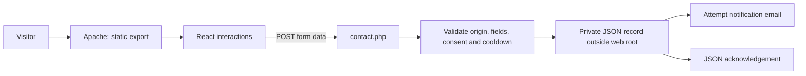

# Architecture and implementation decisions

## Request flow

## Static frontend, native hosting backend

The application uses `output: 'export'` and trailing slashes. The deployment contains pre-rendered pages and client-side interactions. The PHP endpoint is copied from `public/` into the export and executes only on a PHP-capable server. `next dev` is a frontend development environment, not an end-to-end form environment.

The shared-hosting constraint is intentional: an always-on Node service, a separate API deployment, and additional authentication between services are unnecessary for this site's current flow. The tradeoff is that PHP behavior must be validated independently of the Next.js build.

## UI behavior

The main client component owns navigation, FAQ disclosure, intersection-based reveal animations, and form submission state. Page metadata and legal routes remain in the App Router. CSS handles layout and reduced-motion preferences. Business content is visible in the generated HTML rather than fetched from a CMS.

Brand artwork is shared across the main and legal pages. It retains the supplied image and uses SVG viewports and a color-to-alpha filter for integration. The original brand sheet is included for provenance.

## Enquiry boundary

The endpoint checks method, allowed origins, payload size, required fields, email validity, service membership, a honeypot, and response consent. A file lock serializes the per-network cooldown. Enquiries are saved in a sibling directory of the document root, with private directory/file modes, before mail is attempted.

These controls are modest abuse defenses. Origin checks are not authentication, rate limiting is per network rather than per person, and local files are not an encrypted database. No sensitive contracts or banking information should be collected through this form. The UI states that boundary explicitly.

## SEO and content scope

The source includes canonical metadata, social cards, structured data, a sitemap, and robots output. Service copy consistently describes administrative support. State-specific eligibility and licensed work require separate professional review. This project does not establish that any legal text is sufficient for all jurisdictions.

## Verification

CI installs from the lockfile, builds the static export, verifies required pages/assets and internal links, and syntax-checks PHP. Historical browser checks covered desktop/mobile layout, navigation, FAQ behavior, and successful private record persistence during the initial deployment. Those checks do not replace ongoing mail-delivery and production monitoring.

## Future improvements

- Replace the raster-derived logo with an approved transparent SVG.
- Split the main experience into focused components as content grows.
- Add an isolated PHP integration harness for invalid requests, rate limits, and persistence failures.
- Move lead processing to a monitored datastore/queue if volume justifies it.
- Add retention and deletion procedures matched to actual business operations.

## Dependency security maintenance

The initial repository snapshot pinned Next.js 16.4.0. It was upgraded to 16.4.5 on November 6, 2026 following the maintainer advisories. See [the verification record](security-upgrade.md). Production serves exported static files and PHP; it does not run the Next.js server runtime. Dependency audits remain point-in-time checks, not a guarantee against future findings.
